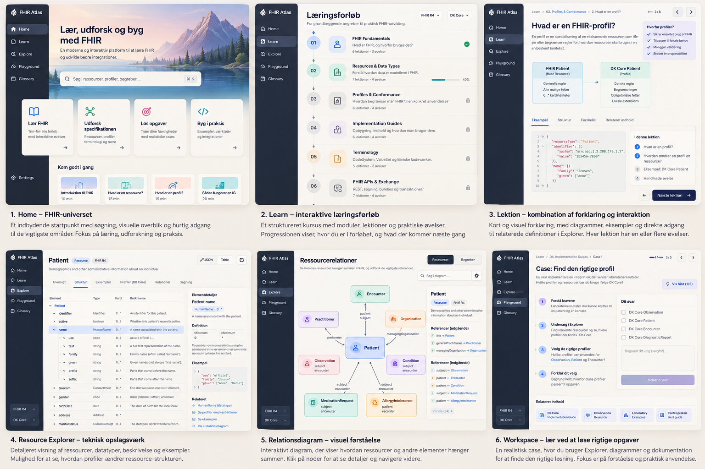

# FHIR Atlas — product & UX brief for Codex

**Status:** agreed concept, ready for planning and iterative implementation.  
**Primary audience:** software developers learning to develop real FHIR integrations, and developers who need a better reference than navigating the official specification by hand.  
**UI and course language:** English (confirmed). This brief is also in English for Codex.

> **Project mission:** Build a genuinely beautiful, innovative, intuitive FHIR learning and reference experience. Teach people **how to think and work as a FHIR developer** — not how to memorize the entire specification. The product must also serve as a useful technical reference to experienced developers.

## 1. Agreed product decisions

- **Two equal pillars:** **Learn** (structured guided education) and **Explore** (technical reference and visual exploration). A contextual **Workspace** integrates both.
- **No AI assistant** in the product.
- **No runtime backend, database, API key, authentication or server to maintain** for v1. Build and data transformation scripts are allowed at build time.
- **Hosting: GitHub Pages**. Public static site; GitHub Actions may build and deploy it. Do not plan Cloudflare Pages or paid cloud hosting.
- **Initial specification scope is confirmed: FHIR R4 (4.0.1) + DK Core.** Choose and pin an actual DK Core package release only after verifying its declared FHIR compatibility and dependencies. Architecture must support additional version/IG pairs later, but v1 exposes only the configured pair.
- **Development order is confirmed: UX-first.** Build and review a polished, interactive prototype using clearly marked, trustworthy seed fixtures *before* building the complete official-package ingestion pipeline. Then connect verified real data and expand incrementally.
- Use **real, authoritative official FHIR machine-readable packages** for specification details. Do not manually hard-code resource definitions for the production reference experience.
- The design mockups are visual direction, **not literal specifications** or proof of complete features.

## 2. Reference mockups



The provided image includes six labeled design concepts:

1. **Home / FHIR Universe:** distinctive welcoming landing page, prominent global search, entry points to Learn, Explore and exercises, continue learning.
2. **Learning path:** concept-driven curriculum, module progression and meaningful learning objectives.
3. **Lesson:** concise explanations, diagrams and real FHIR examples, with links into Explorer.
4. **Resource Explorer:** hierarchy/structure, elements, datatypes, cardinalities, technical detail, examples and profile comparisons.
5. **Relationships:** interactive graph of how resource types connect, with explanatory details.
6. **Workspace:** problem statement remains visible while the user searches the official data, navigates Explorer, investigates a profile, and submits a reasoned answer.

**Visual direction:** premium developer tool meets exceptional interactive learning experience. Polished navigation, clear information hierarchy, careful typographic scale, whitespace, well-designed visualizations, refined motion/microinteractions. Avoid generic template dashboards, default component-library appearance, repetitive cards, or a repainted clone of the official HL7 pages. Maintain a coherent product identity across all six screens. Desktop is a first-class experience; mobile must remain usable. Mockup text/art is illustrative and may be technically inaccurate; only official package data is authoritative.

## 3. Learning philosophy (critical)

- **Understanding and application > memorization.** Do not routinely quiz arbitrary element cardinalities, list every resource, or require recalling exact field names from memory.
- Focus on essential concepts, trade-offs, decision-making, implementation and where/how to find authoritative answers.
- Some exercises should deliberately require learners to **look something up** in Explorer, the IG, or a relationship view. Finding reliable documentation is part of the skill.
- Use realistic scenarios: selecting appropriate resources, distinguishing a resource from a profile, navigating IG constraints, choosing extension vs existing element, terminology basics, references, validation and implementation decisions.
- Provide progressive contextual hints: (1) which general concept/area to examine, (2) which artifact/profile or resource to open, (3) exactly where to inspect; then provide a **reasoned explanation citing the relevant definition**.
- Keep the problem on screen in Workspace while investigating; use appropriate split pane layouts on desktop and task drawers on smaller screens.
- Define learning outcomes per lesson and favor practical exercises over trivia or passive walls of text.
- The goal is a learner who can confidently design and implement FHIR-based integrations, not a person who has memorized the FHIR specification.

## 4. Learning coverage: entire developer foundation, not just resources

Design the information architecture and curricular progression to cover:

1. **FHIR Fundamentals:** purpose, interoperability, HL7 ecosystem, FHIR versions, what FHIR is/is not.
2. **Resources & Data Types:** resource anatomy, primitives/complex types, Reference, identifiers, extensions, CodeableConcept, clinical modeling.
3. **Profiles & Conformance:** StructureDefinition, inheritance/baseDefinition, cardinality principles, constraints, Must Support, slices/slicing, extensions, differential vs snapshot.
4. **Implementation Guides:** what an IG is, how profiles, examples, dependencies, packages and canonical URLs work; using a real chosen IG.
5. **Terminology:** CodeSystem vs ValueSet vs ConceptMap, coding systems, bindings and strengths, interoperability meaning.
6. **FHIR APIs & Exchange:** REST, search, search parameters, CapabilityStatement, Bundle types, pagination and transactions.
7. **Validation & Interoperability:** validation concepts, invariants/FHIRPath, expected failures, IG conformance, versioning and compatibility.
8. **Real-world FHIR Development:** requirements -> modeling -> choosing profiles/terminology -> mapping -> exchange -> tests; realistic clinical integration cases, including potential SUP-to-FHIR examples as a later option.

Curriculum should be modular and could be developed iteratively, **not all content needs to ship on day one**. Have independent topical browsing and a guided sequence powered by the same artifacts.

## 5. Core experiences and product behavior

### A. Home
- Search across resources, profiles, IG artifacts and explanatory concepts.
- Clear entrance to guided learning, reference exploration and exercises.
- Resume local learning progress.
- Show currently selected FHIR version and IG (even while only one is shipped); do not imply unimplemented selections are available.

### B. Learn
- Ordered modules with understandable outcomes, lessons, visuals and active tasks.
- Conceptual diagrams (e.g., FHIR base resource -> derived profile -> application-specific rules).
- Lessons deep-link to **real definition entries in Explorer**.
- Light but accurate progress storage in browser (localStorage or IndexedDB). Make clear it is device-local; no cloud sync.

### C. Explore
- Search and browse **concepts as well as resources**: base resources, StructureDefinitions, profiles, extensions, terminology artifacts, search parameters, IGs.
- For each resource: accessible overview, structured element tree, type/details, examples, references/relationships, source/version metadata.
- For a profile: make **base vs derived constraints** clear, distinguishing original standard requirements from IG-specific changes. Display cardinalities accurately as reference data, not as core memorization objectives.
- Deep links and breadcrumbs; link everything relevant together (datatype -> explanation, profile -> base, element -> referenced resource, artifact -> IG).
- Provide visible provenance/source links into authoritative definitions.

### D. Interactive relationship views
- Resource graph with meaningful typed edges (not inventing business relationships where FHIR only describes possible references).
- Concept graph / explainer: IG -> profiles, extensions, ValueSets, and underlying FHIR definition layer.
- Graph nodes are navigable; selecting a node opens an explanatory detail panel and related reference entries.
- Prioritize legibility, scale and filtering; do not build a massive unreadable hairball.

### E. Task Workspace
- User receives an important developer question / scenario.
- User can inspect the same Explore data and relationship graph without leaving the task.
- Answers may be multi-choice when useful, but also selection, matching, ordering, reasoned choices and guided practical problems; do not force everything into trivia quizzes.
- Structured, locally checkable solutions with feedback, progressive hints, references, and explanation.
- Capture meaningful learning progress on the device; no user account needed.

## 6. Example tasks (focus on concepts, not rote detail)

- **Profile versus resource:** You're integrating with a specific health system. Why isn't implementing the base Patient resource sufficient? Find the chosen IG's Patient profile and examine what changes.
- **Terminology:** A service accepts a set of coded observations. How does a ValueSet differ from a CodeSystem, and which artifact constrains allowed codes?
- **References:** You need to connect a lab observation to its subject and clinical encounter. Explore relevant references and describe how these connections are expressed.
- **Extensions:** A clinical requirement has no obvious home. How do you decide whether to reuse a standard element, an existing extension, or define a new one?
- **IG navigation:** Which profile(s) would you use for a given exchange scenario? Find authoritative evidence in the IG.
- **Validation:** What does it mean for a resource instance to conform to a profile, and how would you find why a sample fails? (No requirement for a complete validator in v1.)

*Avoid basing lessons on unverified claims about DK Core. Ground actual tasks/solutions in the pinned official package contents.*

## 7. Technical architecture: static-first

Suggested starting stack (open to justified refinements during Codex planning):

- **React + TypeScript + Vite** for a fully static, client-rendered site.
- **Tailwind CSS** for expressive custom visual styling, with well-designed reusable components (not generic presets).
- **React Flow / XYFlow** for resource and concept graphs.
- **Static machine-readable source:** pinned official FHIR core NPM package and pinned compatible IG NPM package.
- **Build-time Node.js/TypeScript pipeline** reads packages and derives normalized JSON for resource/profile listings, detailed structures, reference graph edges, terminology metadata and the search index.
- **Static learning content:** curated Markdown/MDX or typed lesson data, with exercises and known answers grounded in source artifacts. Learn / Explore / Workspace reuse common identifiers and navigation.
- **Local-only progress:** localStorage or IndexedDB.
- **GitHub Pages deployment** via GitHub Actions; account for `base` path if site deploys to `https://<owner>.github.io/<repo>/`, correct asset URLs and reliable direct-link routing (hash routing is the simplest robust option, or a tested SPA fallback strategy).
- Organize assets into lazy-loadable chunks or per-artifact JSON. Avoid bundling an enormous full spec into the initial JS download; assess package size and search performance.

```text
Official pinned FHIR R4 + compatible pinned IG packages
                   |
          Build-time pipeline
       (normalize + index + link)
                   |
       Static content + JSON assets
                   |
     React app on GitHub Pages (CDN)
      /          |           \
   Learn       Explore      Workspace
      \          |           /
         Local browser state
```

There is **no runtime application server**. GitHub-hosted build infrastructure is not the same thing as a continuously hosted backend. Running cost can be effectively zero within GitHub Pages/Actions policies and usage limits. No backend for AI, user accounts or FHIR validation is part of v1.

## 8. Architectural boundaries and accuracy

- Respect inheritance/snapshot semantics in `StructureDefinition`. Don't present an IG constraint as a base-standard rule.
- Don't assume IG packages ship all dependencies or complete snapshots; inspect the chosen package and version before planning normalization.
- Avoid presenting a frontend-only partial check as full FHIR validation.
- Respect terminology licensing and avoid indiscriminately bundling licensed code system content.
- Attribute HL7/FHIR content appropriately, show source package/version/canonical URL and check the applicable redistribution/license terms.
- Use **fictional/synthetic patient examples** only. Do not ingest real patient data.
- Ensure search and graph views perform on ordinary laptops and are accessible via keyboard; include reduced-motion support where appropriate.

## 9. UX-first delivery sequence and first shippable vertical slice

**Objective:** prove the premium design and connected learning/reference experience with genuinely correct content, then expand.

1. **UX prototype first:** Create a distinctive design system and clickable Home, Learn, Lesson, Explore, Relationships, and Workspace screens using small, explicitly labeled fixtures. Wire real navigation, split-pane workflows, progressive hints, search interactions, responsive layouts, and local progress. Prototype content is not presented as authoritative documentation.
2. **UX review gate:** Present working screens for approval and refine information architecture, typography, interaction patterns, and visual identity before pursuing broad ingestion.
3. **Static deployment:** Configure Vite and GitHub Actions for GitHub Pages, test project path asset URLs and deep links.
4. **Package feasibility spike:** Verify and pin compatible FHIR R4 (4.0.1) and DK Core package releases, inspect dependency/snapshot/data formats and license constraints, and define a normalized model.
5. **Real-data vertical slice:** Generate a small accurate subset from packages (e.g. Patient and Observation plus one real DK Core profile), swap fixtures out in Explorer, show source metadata and base-vs-profile differences.
6. **Connected experience:** Wire one genuine typed relationship graph, one short concept lesson (e.g. Resource vs Profile vs IG) and one exploratory exercise requiring a lookup.
7. **Quality gate:** Verify correct content, reliable GitHub Pages deployment, working inter-screen navigation, device-local progress, accessibility and tests. Then expand the catalog and curriculum in milestones.

Use seed fixtures for early UI prototyping if needed, but replace with verified package-derived data before claiming reference functionality.

## 10. Out of scope for initial implementation

- AI assistant or AI-generated runtime answers.
- Backend, database, auth, cloud sync, user profiles.
- Full FHIR server, server-to-server API proxy, writes to EHR systems.
- Full-fledged FHIR validator or terminology server.
- Arbitrary user-uploaded IGs and multi-version selection UI with unsupported options.
- Production-ready content for all eight curricular modules at once.

## 11. Definition of done for first slice

- Looks like a distinct premium learning/developer product, not a default CRUD dashboard or official docs clone.
- Github Pages deployment actually works including refresh and links on project subpaths.
- Zero runtime backend calls needed for in-scope features.
- Correct base vs IG information and source references for selected resources/profiles.
- Can begin learning, inspect a real definition in Explorer, return to an exercise and complete it with evidence-based feedback.
- Graph includes real typed relationships with click-through navigation.
- Responsive, keyboard-usable, reasonable loading performance; no fake links or dead controls.
- Typecheck, lint and relevant tests pass; normalization is tested on genuine pinned package fixtures.

## 12. Locked decisions and remaining implementation details

**LOCKED: FHIR scope:** FHIR R4 (4.0.1) + DK Core; architect for later version and IG expansion, but do not advertise unavailable selections.

**LOCKED: Product language:** All v1 interface text, lessons, questions, explanations and example commentary in **English**. Design clean content boundaries so localization can be added later, but do not build translation infrastructure in v1.

**LOCKED: Delivery priority:** **UX prototype first**, review before building the complete FHIR package parser.

**LOCKED: GitHub Pages** hosting, static-only, no AI, no backend.

**TO VERIFY, not user-facing product indecision:** Determine an actually compatible DK Core NPM package release, its dependencies, and required attribution before ingesting official data. Do not guess the latest version is compatible.

**TO CONFIGURE:** Repo name and final GitHub Pages URL. Start with project Pages (`/<repo>/`) and configurable Vite base path; this should not block UX prototyping.

**TO REFINE THROUGH PROTOTYPE:** Exact visual language and accessibility patterns; the mockups provide direction but are not a pixel-perfect contract.

None of these requires a runtime backend.

## 13. Instructions for Codex

1. **Start with planning, not a large implementation.** Read this brief and inspect the visual reference.
2. Respect the locked choices in §12. Verify DK Core release compatibility prior to real ingestion; ask only for genuinely blocking details, not already settled product questions.
3. Propose: information architecture and user journeys; UX components and wireframes; static content/package model; phased GitHub issues or work packages; test strategy; GitHub Pages deployment.
4. Deliver the **interactive UX prototype as the first milestone**, using labeled fixtures, then seek approval before broader parser/content development. Ask for approval of the plan before launching extensive implementation.
5. Keep implementation understandable and explain important FHIR and architectural choices as you work. The project is also a learning project.
6. Never replace verified definitions with guessed examples, and never broaden v1 into full backend / AI features.
